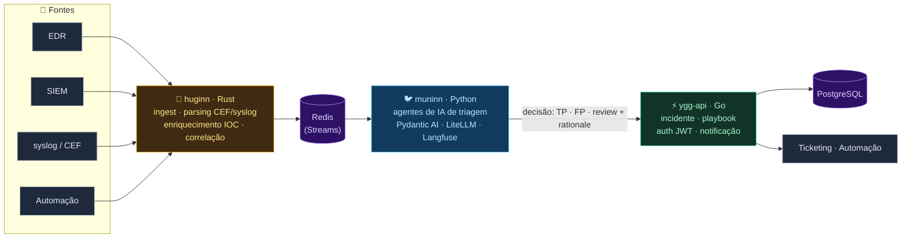

<div align="center">

# 🌳 Yggdrasil

**SOAR open source — AI-powered — para triagem de alertas de segurança**

Automatize a triagem que hoje o SOC faz na mão. **Yggdrasil** ingere eventos,
normaliza, enriquece e correlaciona — e usa agentes de IA para decidir se um
alerta é **verdadeiro positivo**, **falso positivo** ou precisa de **atenção
humana** — com decisão rastreável e explicável.

[](#)
[](#)
[](#)
[](#)

---

## 🧠 Por que Yggdrasil?

No SOC, uma boa parte do tempo vai para **decidir se o alerta é real**. Esse
julgamento é repetitivo, caro e sujeito a erro. O Yggdrasil coloca a IA nesse
julgamento — mantendo o analista no controle e a decisão auditável.



## 🛠️ Serviços

| Serviço | Linguagem | Papel |
|:--------|:----------|:------|
| **ygg-api** | Go | API gateway · auth JWT · playbooks · incidentes |
| **huginn** | Rust | ingest de eventos · parsing CEF/syslog · IOC · correlação |
| **muninn** | Python | agentes de IA de triagem · gateway LLM · observabilidade |

## 🏗️ Stack

| Camada | Escolha |
|:--------|:--------|
| **APIs** | HTTP (contrato síncrono — **ADR-002 em decisão**, spike) |
| **Dados** | PostgreSQL (estruturado) + Redis (streams/cache) |
| **IA** | Pydantic AI + LiteLLM + Langfuse |
| **Deploy** | Kubernetes + kustomize |

## 📐 Decisões de arquitetura (ADRs)

Toda decisão importante fica em [`docs/adr/`](docs/adr/). Leia antes de codar.

| ADR | Tema | Status |
|:----|:-----|:------|
| **001** | Linguagem por camada (Go/Rust/Python) | ✅ Aceito |
| **002** | Protocolo síncrono entre serviços (gRPC vs REST) | 🚧 Em aberto (spike) |
| **003** | Storage Postgres + Redis | ✅ Aceito |
| **004** | AI layer LiteLLM + Pydantic AI + Langfuse | ✅ Aceito |

## 🚀 Começando

```sh
# 1) clone
git clone https://github.com/somoza00/Yggdrasil.git && cd Yggdrasil

# 2) prepare o .env (copie de .env.example)
cp .env.example .env

# 3) rode os testes dos 3 serviços
make test

# 4) suba o ambiente dev (Postgres, Redis, Langfuse e os 3 serviços)
make dev-up
```

> Cada serviço tem seu `.env.example` próprio — copie para `.env` (nunca
> commitar `.env`).

## 🧪 Qualidade e gates

```sh
make test       # testes de todos os serviços
make lint       # go vet / cargo clippy / ruff check
make fmt        # gofmt / cargo fmt / ruff format
```

| Serviço | Gate |
|:--------|:-----|
| ygg-api | `go vet` + `gofmt` + `go test ./...` |
| huginn | `cargo fmt` + `cargo clippy` + `cargo test` |
| muninn | `ruff` + `mypy` + `pytest --cov` |

> **Toolchains nesta máquina:** Go e Python/uv instalados. Rust (rustc/cargo),
> kubectl, kustomize e helm precisam ser instalados (ver `make setup`).

## 🗺️ Roadmap

- [x] Scaffold do monorepo (3 serviços + ADRs + deploy)
- [ ] **Spike ADR-002** — decidir gRPC vs REST para o contrato síncrono
- [ ] Auth JWT real no ygg-api + CRUD de playbooks
- [ ] Ingest ponta-a-ponta do Redis Stream até a triagem
- [ ] Avaliação das triagens da IA contra o veredito do analista (Langfuse)

## 🧭 Contexto para agentes de IA

Sessões futuras de IA (e humanos) devem ler o
[**`AGENTS.md`**](AGENTS.md) — arquitetura, regras de git, gates e convenções.

## 📄 Licença

Distribuído sob a **Apache License 2.0**. Veja [`LICENSE`](LICENSE).

---

<div align="center">
  <sub>Idealizado a partir do dia a dia de um SOC N1.<br>Feito para quem quer
  triar menos e investigar mais. 🔍</sub>
</div>
</div>